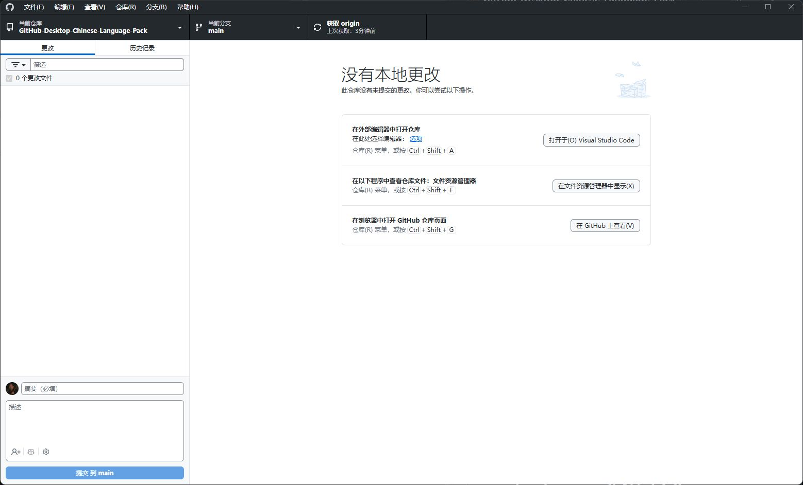
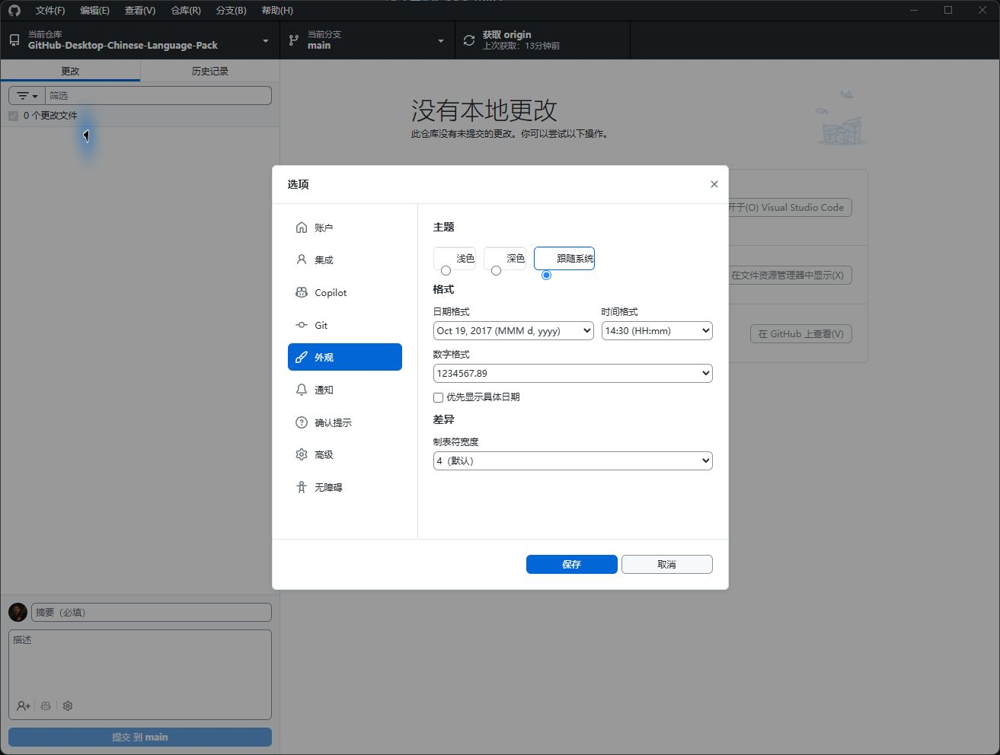
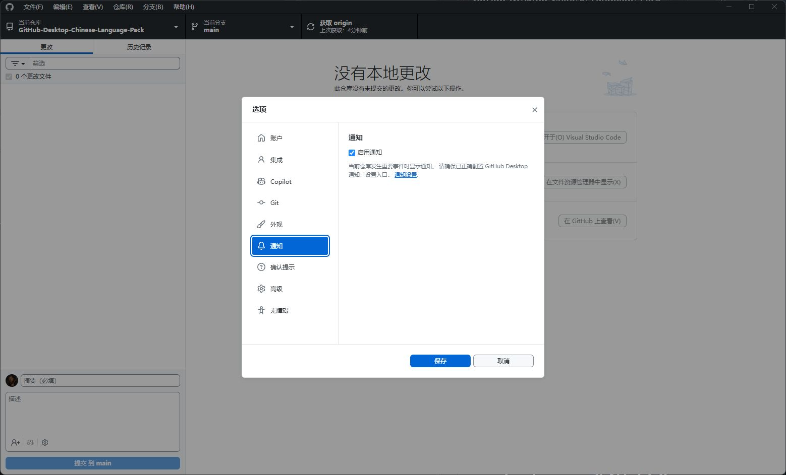
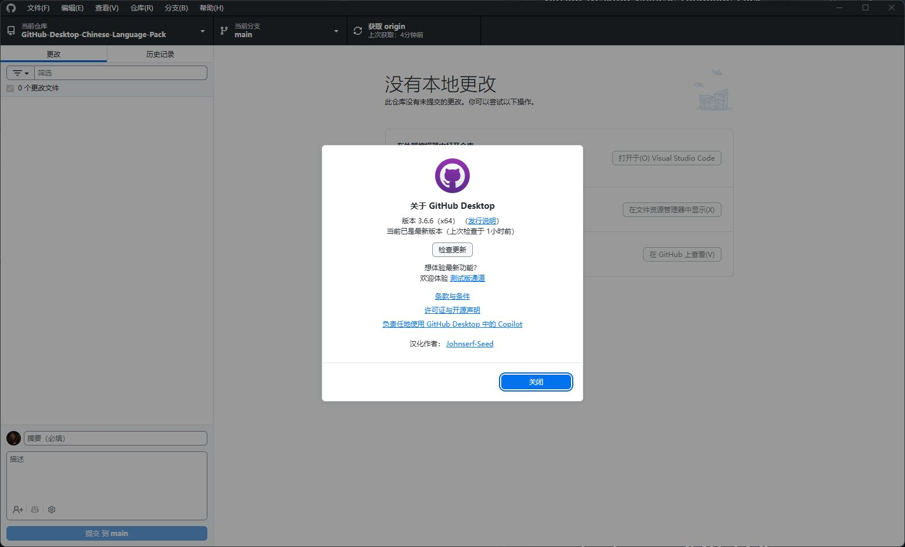

# GitHub Desktop 简体中文汉化包

为 Windows 版 GitHub Desktop 提供简体中文界面。当前主分支提供 **3.7.0（Windows x64）** 汉化包，覆盖菜单、分支、提交、差异和设置，并补充了 Copilot 辅助提交、仓库账户选择和缺失工作树提示。

**[下载 3.7.0 项目 ZIP](https://github.com/Johnserf-Seed/GitHub-Desktop-Chinese-Language-Pack/archive/refs/heads/main.zip)** · [查看汉化包](app-3.7.0/) · [历史版本](#历史版本) · [汉化效果截图](#汉化效果截图)

## 安装 3.7.0

1. 在 GitHub Desktop 的 **Help → About GitHub Desktop**（帮助 → 关于）确认版本为 **3.7.0**。其他版本请从下方表格下载。
2. 下载并解压项目 ZIP，进入其中的 `app-3.7.0/` 文件夹。
3. 正常退出 GitHub Desktop，双击 `install.cmd`。提示安装成功后重新启动，即可看到中文界面。

安装无需管理员权限。首次安装会备份原文件，重复安装同一份包会保留最初的备份。

| 你想做什么 | 操作 |
| --- | --- |
| 恢复英文界面 | 退出程序，运行同一文件夹中的 `restore.cmd`。 |
| GitHub Desktop 已升级 | 下载与新版本号完全匹配的包，退出程序后直接安装。各版本分别保存备份。 |
| 更新同一版本的汉化 | 退出程序，先运行新包中的 `restore.cmd`，再运行 `install.cmd`。 |

## 历史版本

`main` 只保留最新的预制汉化包。每个历史版本都有独立的 `version/版本号` 分支，包含对应文件和安装说明。

| GitHub Desktop 版本 | 安装说明 | 下载 |
| --- | --- | --- |
| 3.6.11 | [查看 3.6.11 分支](https://github.com/Johnserf-Seed/GitHub-Desktop-Chinese-Language-Pack/tree/version/3.6.11) | [下载 ZIP](https://github.com/Johnserf-Seed/GitHub-Desktop-Chinese-Language-Pack/archive/refs/heads/version/3.6.11.zip) |
| 3.6.7 | [查看 3.6.7 分支](https://github.com/Johnserf-Seed/GitHub-Desktop-Chinese-Language-Pack/tree/version/3.6.7) | [下载 ZIP](https://github.com/Johnserf-Seed/GitHub-Desktop-Chinese-Language-Pack/archive/refs/heads/version/3.6.7.zip) |
| 3.6.6 | [查看 3.6.6 分支](https://github.com/Johnserf-Seed/GitHub-Desktop-Chinese-Language-Pack/tree/version/3.6.6) | [下载 ZIP](https://github.com/Johnserf-Seed/GitHub-Desktop-Chinese-Language-Pack/archive/refs/heads/version/3.6.6.zip) |
| 3.1.6 | [查看 3.1.6 分支](https://github.com/Johnserf-Seed/GitHub-Desktop-Chinese-Language-Pack/tree/version/3.1.6) | [下载 ZIP](https://github.com/Johnserf-Seed/GitHub-Desktop-Chinese-Language-Pack/archive/refs/heads/version/3.1.6.zip) |

3.1.6 使用手动替换文件的安装方式。请按该分支的说明先备份原文件。

## 汉化效果截图

以下截图取自 3.6.6 的实际界面。点击可查看原图。

查看外观设置、通知设置和关于页面

## 生成新版汉化包

如果官方已更新，而上面还没有对应版本，可以从 Actions 下载，也可以在本机生成。生成后由你手动安装。

| 来源 | 使用方法 |
| --- | --- |
| GitHub Actions | 每周一北京时间 10:00 计划生成官方 Windows x64 稳定版的汉化包。在成功运行的 **Artifacts** 中下载对应版本，解压外层下载包和内层 ZIP。产物保留 30 天。[查看运行记录](https://github.com/Johnserf-Seed/GitHub-Desktop-Chinese-Language-Pack/actions/workflows/update-language-pack.yml) |
| 本机已安装的正式版 | 安装 Node.js 22 或更高版本，双击项目根目录的 `generate.cmd`，在 `dist/` 获取结果。如果该版本已经汉化，先恢复英文原版。 |
| 官方最新 Windows x64 稳定版 | 安装 Node.js 22 或更高版本及 7-Zip，双击 `generate-latest.cmd`。工具下载官方安装包并解包，生成结果同样保存在 `dist/`。 |

自动生成会复用已审核的翻译，新版出现的文案可能暂时保留英文。每周生成的下载包通过 Actions 提供，主分支中的预制包由维护者更新。

## 反馈与贡献

遇到漏译或安装问题，请在 Issue 中提供完整版本号、界面位置、截图或报错原文。也欢迎通过 Pull Request 补充简体中文词典。[提交反馈](https://github.com/Johnserf-Seed/GitHub-Desktop-Chinese-Language-Pack/issues) · [查看词典](locales/zh-CN.json)

本项目是社区维护的 GitHub Desktop Chinese Language Pack。汉化工具使用 MIT 许可证，GitHub Desktop 及第三方组件保留各自的许可证。[汉化作者 Johnserf-Seed](https://github.com/Johnserf-Seed) · [许可证](LICENSE)
